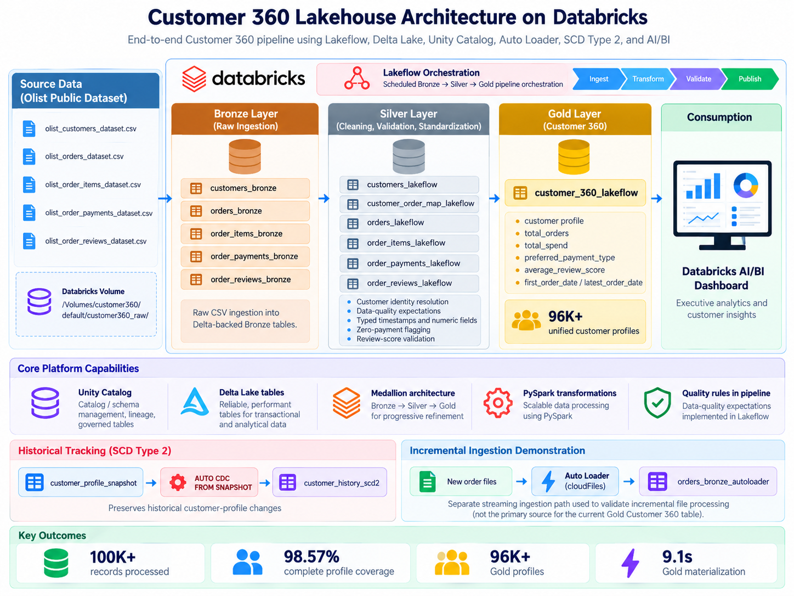
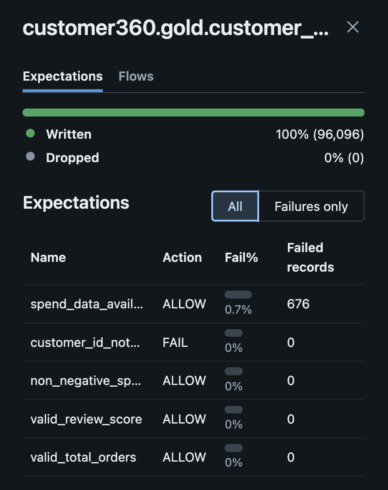
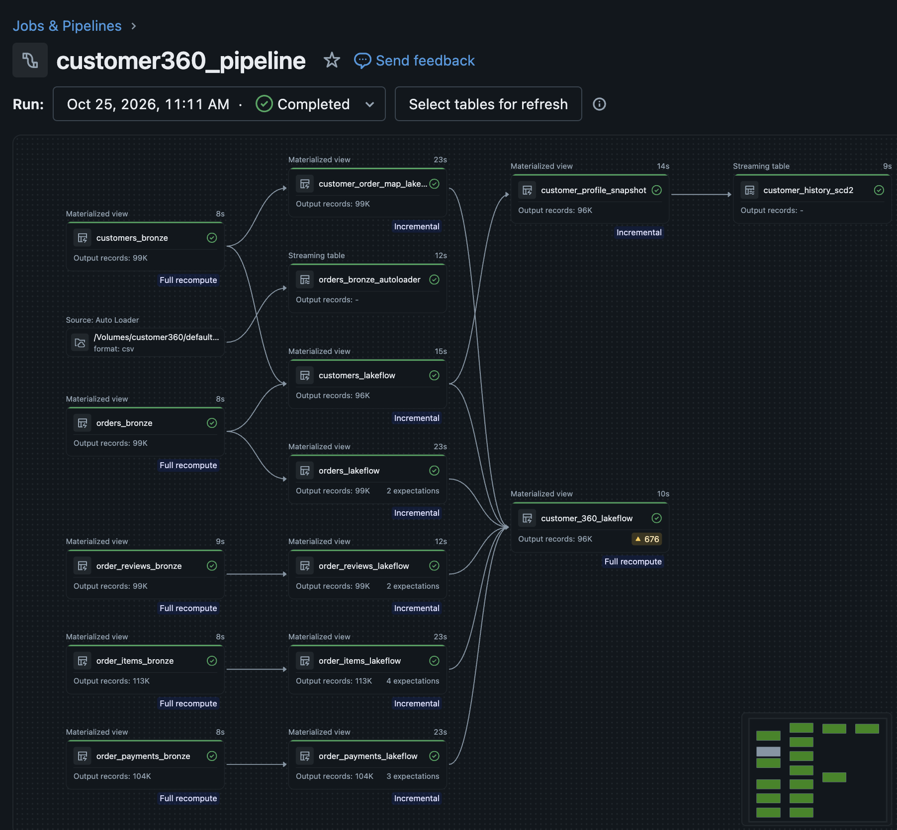
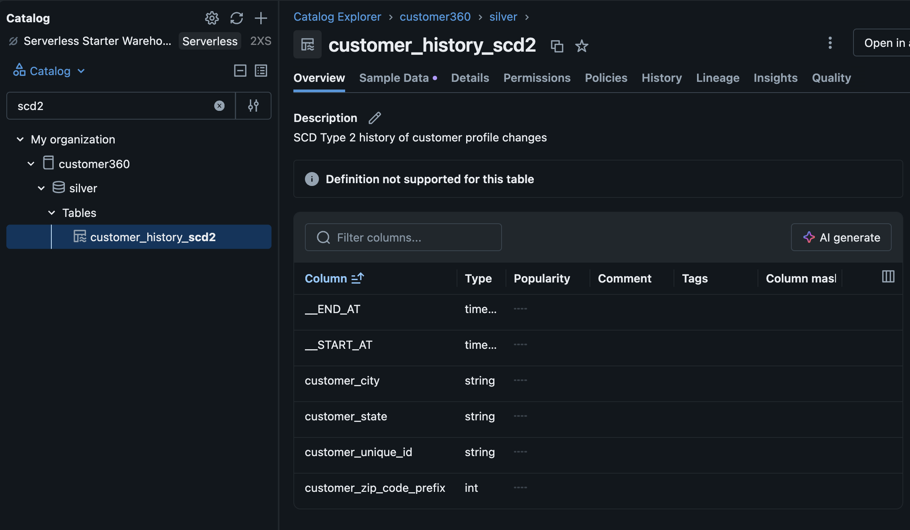
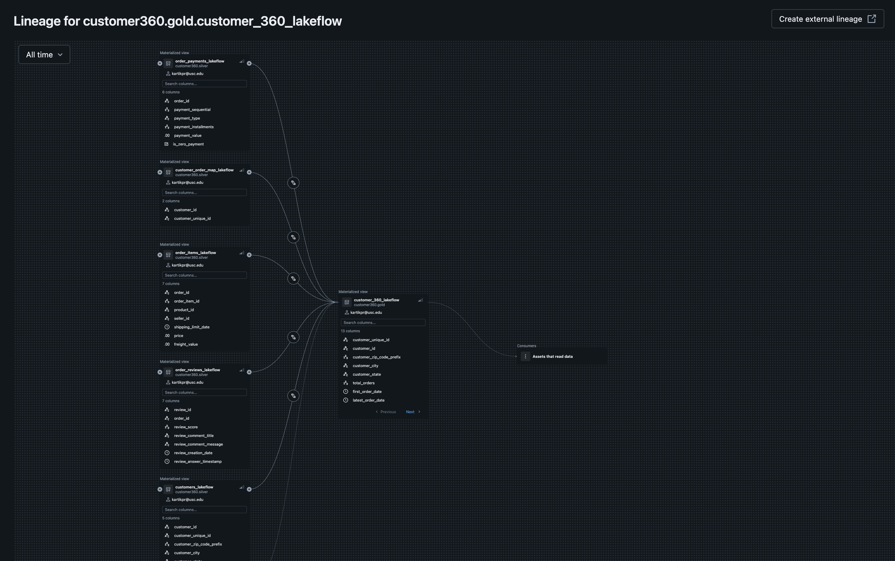
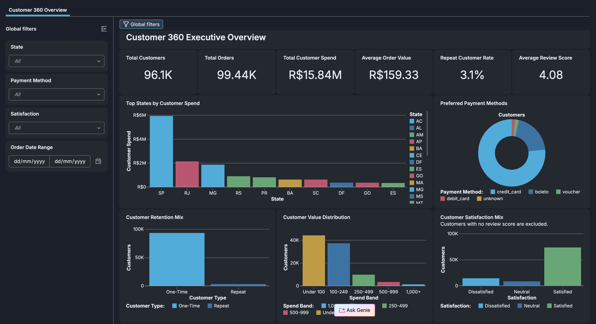

# Enterprise Customer 360 Lakehouse

A Databricks Customer 360 lakehouse that brings customer identity, orders, spend, payment behavior, and satisfaction into one governed analytics layer.

Built with **Databricks, PySpark, Delta Lake, Lakeflow, Auto Loader, Unity Catalog, Medallion Architecture, SCD Type 2, and Databricks AI/BI**.

The project uses the public **Olist Brazilian E-Commerce dataset** and focuses on the parts of a real data platform that matter beyond simply transforming a CSV: orchestration, incremental ingestion, data quality, historical tracking, lineage, performance, and an analytics-ready consumption layer.

---

## Project Overview

Customer information in transactional systems is rarely available as one clean, analysis-ready record.

In the Olist dataset, customer identity, order activity, line-item value, payment behavior, and review information are distributed across multiple datasets. A customer may also appear under different order-level customer identifiers across transactions.

The objective of this project was to build a governed Customer 360 layer that could answer questions such as:

- Who is the customer across multiple orders?
- How many orders has each customer placed?
- How much has each customer spent?
- What is their average order value?
- Which payment method do they prefer?
- How satisfied are they based on review behavior?
- How complete and trustworthy is the resulting customer profile?
- How can changes to customer attributes be historically tracked?

The final Gold layer contains **96K+ unified customer profiles** with customer identity, geography, order history, spend, payment preference, and review metrics.

---

## Architecture



The project follows a **Medallion Architecture** with governed Bronze, Silver, and Gold layers inside Databricks.

The primary analytics path uses Lakeflow-managed Bronze datasets, validated Silver transformations, and a unified Gold Customer 360 table.

A separate Auto Loader path was also implemented to demonstrate incremental file ingestion for newly arriving order files. This path is intentionally kept separate from the current Gold dependency chain so that the architecture reflects what is actually running rather than overstating the implementation.

---

## Technology Stack

| Area | Technology |
|---|---|
| Lakehouse Platform | Databricks |
| Processing | PySpark, Spark SQL |
| Storage | Delta Lake |
| Pipeline Framework | Lakeflow Declarative Pipelines |
| Orchestration | Scheduled Lakeflow pipeline execution |
| Incremental Ingestion | Databricks Auto Loader |
| Data Architecture | Bronze, Silver, Gold Medallion Architecture |
| Governance | Unity Catalog |
| Data Quality | Lakeflow Expectations |
| Historical Tracking | SCD Type 2 using Auto CDC from Snapshot |
| Analytics | Databricks AI/BI |
| Source | Olist Brazilian E-Commerce Dataset |
| Version Control | GitHub |

---

## Source Data

The project uses five Olist datasets.

| Dataset | Rows | Purpose |
|---|---:|---|
| Customers | 99,441 | Customer identity and geographic attributes |
| Orders | 99,441 | Order status and lifecycle timestamps |
| Order Items | 112,650 | Product-level order value and freight |
| Payments | 103,886 | Payment method, installments, and payment value |
| Reviews | 99,224 | Customer review scores and review metadata |

Across these five datasets, the pipeline processes more than **500K source rows**.

The source files are stored in a Databricks Volume and ingested into the Bronze layer.

---

# Data Pipeline

## Bronze Layer

The Bronze layer preserves source-level information while establishing reliable datasets for downstream processing.

The pipeline creates Bronze materialized views for:

```text
customers_bronze
orders_bronze
order_items_bronze
order_payments_bronze
order_reviews_bronze
```

For most datasets, schema inference is sufficient for initial ingestion.

The reviews dataset required additional handling because review text contains multiline content and quoted strings. A standard CSV read produced malformed records and invalid values, so the ingestion logic was updated to correctly handle multiline records, quoting, and escaping.

This was particularly important because downstream review metrics would otherwise appear valid while being calculated from incorrectly parsed rows.

The corrected ingestion uses CSV parsing options specifically designed for multiline review content before the data enters the Silver layer.

---

## Silver Layer

The Silver layer converts raw datasets into trusted analytical entities.

The pipeline produces:

```text
customer360.silver.customers_lakeflow
customer360.silver.orders_lakeflow
customer360.silver.order_items_lakeflow
customer360.silver.order_payments_lakeflow
customer360.silver.order_reviews_lakeflow
customer360.silver.customer_order_map_lakeflow
```

### Customer Identity Resolution

One of the most important modeling decisions in the project was understanding the difference between:

```text
customer_id
```

and:

```text
customer_unique_id
```

`customer_id` represents the customer identifier associated with an individual order.

`customer_unique_id` represents the actual customer across transactions.

The raw customer dataset contains:

```text
99,441 customer_id values
96,096 customer_unique_id values
```

Using `customer_id` directly as the analytical customer key would therefore fragment repeat customers into multiple profiles.

The Silver customer transformation joins customers to orders, partitions records by `customer_unique_id`, orders them by the most recent purchase timestamp, and retains the latest customer profile.

This creates one current profile per actual customer.

A separate customer-order mapping is retained so every historical order can still be associated with the correct `customer_unique_id`.

---

## Data Quality Expectations

Data-quality rules are applied directly within the Lakeflow pipeline rather than being handled only through manual validation queries.

Examples include:

```text
Order ID must not be NULL
Product ID must not be NULL
Price must be greater than zero
Freight must be non-negative
Payment value must be non-negative
Installments must be non-negative
Review score must be between 1 and 5
Customer unique ID must not be NULL
Total orders must be greater than zero
```

Some rules use `expect_or_fail` where a violation should stop invalid records from progressing.

Others use `expect` where the objective is to observe and measure data-quality conditions without unnecessarily failing the entire pipeline.



### Why the spend rule changed

An early Gold expectation treated missing spend as a failure under the same rule used to validate non-negative spend.

Approximately **676 customer profiles**, around **0.7%**, failed that rule.

The first assumption could easily have been that the spend logic was broken.

Instead, the affected orders were traced back to their source order statuses.

The missing spend records were primarily associated with orders such as:

```text
unavailable
canceled
created
invoiced
shipped
```

These customers could legitimately have an order record without a completed line-item spend value.

The quality logic was therefore split into two different concepts:

**Completeness**

```text
spend_data_available:
total_spend IS NOT NULL
```

**Validity**

```text
non_negative_spend:
total_spend IS NULL OR total_spend >= 0
```

This distinction matters.

A missing value does not automatically mean the data is invalid.

The final pipeline reports missing spend transparently while still validating that all available spend values are non-negative.

---

# Gold Customer 360

The Gold layer is designed around one question:

> What information would an analyst or business user expect to find in a single customer profile?

The final table is:

```text
customer360.gold.customer_360_lakeflow
```

It combines customer identity with order activity, spending behavior, preferred payment method, and customer satisfaction.

### Order Behavior

For each customer, the pipeline calculates:

```text
total_orders
first_order_date
latest_order_date
```

Orders are mapped from `customer_id` to `customer_unique_id` before aggregation so repeat activity is attributed to the correct customer.

### Customer Spend

Order value is calculated as:

```text
price + freight_value
```

Line items are aggregated to the order level before customer-level spend is calculated.

Customer metrics include:

```text
total_spend
average_order_value
```

### Preferred Payment Method

Payments can contain multiple records per order.

Rather than taking an arbitrary payment value, the pipeline counts payment-method usage for each customer and ranks payment methods using a window function.

The highest-frequency payment method becomes:

```text
preferred_payment_type
```

### Customer Satisfaction

Some orders contain multiple review records.

Review scores are therefore first aggregated at the order level and then rolled up to the customer level.

The Gold profile includes:

```text
average_review_score
reviewed_orders
```

This avoids allowing an order with multiple review rows to disproportionately influence the customer's overall satisfaction score.

---

# Lakeflow Orchestration

The transformation logic is implemented using **Lakeflow Declarative Pipelines**.

Rather than manually executing notebooks in a specific sequence, Lakeflow understands dependencies between pipeline datasets and executes transformations according to the dependency graph.



The graph shows the relationship between source-level Bronze datasets, validated Silver entities, historical customer tracking, and the final Gold Customer 360 table.

The pipeline is also configured for scheduled execution, making the workflow repeatable rather than dependent on manual notebook execution.

This makes the project closer to how a recurring data product would be operated in practice.

---

# Incremental Ingestion with Auto Loader

In addition to the main batch ingestion path, the project includes a separate Auto Loader implementation for order ingestion.

The Auto Loader dataset uses:

```python
spark.readStream \
    .format("cloudFiles") \
    .option("cloudFiles.format", "csv")
```

and reads order files matching the configured file pattern from the Databricks Volume.

The purpose of this implementation was to validate how newly arriving files could be ingested incrementally rather than re-reading the entire source location as a traditional batch operation.

### Incremental ingestion validation

The initial Auto Loader table contained:

```text
Total rows:       99,441
Unique order IDs: 99,441
```

To test incremental file discovery, a new test file containing 10 existing order rows was introduced under a new filename.

After the next pipeline execution:

```text
Total rows:       99,451
Unique order IDs: 99,441
```

The increase in total rows confirmed that Auto Loader discovered and processed the newly arriving file.

The unique order count remained unchanged because the test intentionally reused existing order records. The objective was to test incremental file ingestion, not generate artificial business transactions.

After validation, the test file was removed and the Auto Loader table was refreshed back to the clean source state.

### Important architecture note

The Auto Loader table is currently a **separate incremental-ingestion demonstration path**.

The production Gold Customer 360 dependency chain continues to use the batch `orders_bronze` dataset.

This distinction is intentional and documented so the repository accurately represents the implemented architecture.

A future iteration could replace the batch order-ingestion source with the Auto Loader stream once a continuously arriving source system is available.

---

# SCD Type 2 Customer History

Customer attributes such as location can change over time.

If the current record is simply overwritten, historical analysis loses the state that was valid when earlier events occurred.

To support historical customer attributes, the pipeline creates a current customer-profile snapshot containing:

```text
customer_unique_id
customer_zip_code_prefix
customer_city
customer_state
```

Lakeflow then maintains:

```text
customer360.silver.customer_history_scd2
```

using Auto CDC from Snapshot with:

```text
stored_as_scd_type = 2
```



The resulting history table contains SCD metadata such as:

```text
__START_AT
__END_AT
```

allowing previous versions of a customer's profile to remain historically available instead of being overwritten.

### Static dataset limitation

The Olist dataset is a historical static snapshot.

Because no continuously changing customer source is arriving, the current project demonstrates the **SCD Type 2 framework and change-tracking design** rather than claiming a large historical series of real customer profile changes.

As future snapshots change, the SCD2 table is designed to preserve those historical versions.

---

# Unity Catalog Governance and Lineage

The project is organized under Unity Catalog using separate Bronze, Silver, and Gold schemas.

This provides a clear governed namespace for the data product and makes lineage visible across transformations and analytics assets.



The lineage graph shows Silver entities feeding the Gold Customer 360 table and the Gold dataset being consumed by the downstream AI/BI dashboard.

This gives a direct view of where the data originated, how it was transformed, and where it is being used.

For a Customer 360 product, this traceability is especially useful because business-facing customer metrics often combine data from several operational domains.

---

# Databricks AI/BI Dashboard

The Gold Customer 360 table is consumed through a Databricks AI/BI dashboard designed as the analytical layer of the project.



The dashboard focuses on customer value and behavior rather than exposing raw engineering metrics.

It includes views for areas such as:

```text
Total Customers
Total Orders
Total Customer Spend
Average Order Value
Repeat Customer Rate
Customer Satisfaction
Customer Spend by State
Preferred Payment Methods
Customer Value Distribution
Customer Retention Mix
Customer 360 Data Quality
```

Because the dataset represents Brazilian e-commerce transactions, monetary values are displayed in **Brazilian Real (BRL)**.

The dashboard intentionally avoids visualizations that primarily expose anonymous customer IDs without business meaning.

The goal is to provide an executive-level view of customer value, behavior, geography, payment preference, satisfaction, and profile completeness.

---

# Pipeline Performance

Pipeline execution was reviewed using Databricks pipeline performance and query history.


In the captured run, the final Gold Customer 360 dataset containing approximately **96K customer profiles materialized in 9.1 seconds**.

This number is reported as an observed execution result from the captured Databricks run.

It is not presented as a performance improvement percentage because the project did not establish a comparable pre-optimization baseline.

Other pipeline stages execute independently based on Lakeflow dependencies, so individual task durations should not be added together to estimate total pipeline execution time.

---

# Validated Results

| Metric | Result |
|---|---:|
| Customer source records | 99,441 |
| Unique customers | 96,096 |
| Gold Customer 360 profiles | 96,096 |
| Duplicate Gold profiles | 0 |
| Complete Customer 360 profiles | 94,720 |
| Complete profile coverage | **98.57%** |
| Order coverage | **100%** |
| Payment coverage | **100%** |
| Spend coverage | **99.3%** |
| Review coverage | **99.25%** |
| Missing spend profiles | 676 |
| Negative spend profiles | 0 |
| Observed Gold materialization | **9.1 seconds** |

A complete Customer 360 profile represents a profile with the required order, spend, payment, and review information available for the unified analytical view.

The remaining incomplete profiles are retained rather than artificially filled so that downstream consumers can distinguish genuine missingness from valid zero values.

---

# Engineering Challenges

## 1. Customer identity was not the same as order identity

The customer dataset contains both order-level `customer_id` values and cross-order `customer_unique_id` values.

Treating the wrong field as the customer key would have created fragmented customer profiles and distorted repeat-purchase metrics.

The solution was to preserve the customer-order relationship while building the Gold layer around `customer_unique_id`.

---

## 2. Review data could not be treated as a simple CSV

Review comments contain multiline text and quoted content.

A normal CSV read caused malformed parsing and invalid values.

The Bronze review ingestion was therefore configured with explicit multiline, quote, and escape handling before review scores and timestamps were standardized in Silver.

---

## 3. Missing spend did not automatically mean bad data

A strict spend rule initially classified approximately 0.7% of profiles as quality failures.

Root-cause analysis showed that many of those profiles belonged to canceled, unavailable, or incomplete orders.

Instead of converting NULL spend to zero, which would change its business meaning, the pipeline separates completeness from validity.

This preserves the original information while still enforcing non-negative values whenever spend is present.

---

## 4. Repeat customers required an explicit identity mapping

The raw customer table contains more customer records than actual unique customers.

The pipeline maintains a dedicated `customer_id` to `customer_unique_id` mapping so orders, payments, reviews, and spend can be correctly attributed to the same customer across transactions.

---

## 5. Incremental ingestion was tested without manufacturing business data

Auto Loader was validated using a small controlled file-arrival test.

Existing rows were intentionally introduced under a new filename so the test could verify incremental discovery without pretending they were new customer transactions.

This made the ingestion behavior measurable while keeping the underlying business dataset unchanged.

---

# Repository Structure

```text
databricks-customer360-lakehouse/
│
├── README.md
│
├── pipelines/
│   └── customer360_pipeline.py
│
├── architecture/
│   └── customer360_architecture.png
│
└── screenshots/
    ├── customer360_dashboard.png
    ├── lakeflow_pipeline.png
    ├── pipeline_performance.png
    ├── quality_expectations.png
    ├── scd2_history.png
    └── unity_catalog_lineage.png
```

The production transformation logic is kept in a single pipeline file so the complete Lakeflow dependency structure can be reviewed without navigating through multiple exploratory notebooks.

The repository intentionally excludes raw datasets and temporary test files.

---

# How to Reproduce

## 1. Create the Databricks catalog structure

Create a catalog named:

```text
customer360
```

Create the required schemas:

```text
bronze
silver
gold
```

Create a Volume for the raw source files.

The pipeline currently expects source data under:

```text
/Volumes/customer360/default/customer360_raw/
```

---

## 2. Add the source datasets

Upload the following Olist files to the raw Volume:

```text
olist_customers_dataset.csv
olist_orders_dataset.csv
olist_order_items_dataset.csv
olist_order_payments_dataset.csv
olist_order_reviews_dataset.csv
```

The raw data itself is not included in this repository.

---

## 3. Create a Lakeflow pipeline

Create a Databricks Lakeflow Declarative Pipeline and use:

```text
pipelines/customer360_pipeline.py
```

as the pipeline source.

Ensure the pipeline has permission to read the source Volume and create objects in the `customer360` catalog.

---

## 4. Run the pipeline

The first successful run should create the Bronze, Silver, Gold, Auto Loader, and SCD2 objects defined in the project.

Review the Lakeflow graph to verify dataset dependencies.

---

## 5. Review data-quality expectations

Inspect expectation results at both Silver and Gold layers.

Pay particular attention to:

```text
spend_data_available
non_negative_spend
valid_review_score
valid_total_orders
```

The expected spend-completeness result reflects legitimate incomplete orders and should not be converted into an artificial zero value.

---

## 6. Validate the Gold layer

Verify:

```text
96,096 Gold profiles
96,096 unique customer_unique_id values
0 duplicate customer profiles
```

The Gold table should contain customer identity, order behavior, spend, payment preference, and review metrics.

---

## 7. Review SCD Type 2 history

Open:

```text
customer360.silver.customer_history_scd2
```

and inspect the SCD metadata columns.

Historical versions will accumulate as future customer snapshots contain attribute changes.

---

## 8. Build the AI/BI consumption layer

Use:

```text
customer360.gold.customer_360_lakeflow
```

as the primary dashboard dataset.

The dashboard in this project focuses on customer value, retention, geography, payment preference, satisfaction, and data completeness.

---

# Key Design Decisions

### Preserve NULL instead of forcing zero

Missing spend represents missing transactional value, not necessarily zero customer value.

The pipeline preserves that distinction.

### Aggregate reviews at the order level first

This prevents orders with multiple review rows from receiving disproportionate influence in customer-level satisfaction metrics.

### Resolve identity before customer aggregation

Customer-level metrics are based on `customer_unique_id`, not the order-level `customer_id`.

### Keep Auto Loader claims separate from the Gold dependency path

The project demonstrates Auto Loader incremental ingestion, but the current Gold pipeline still reads from the batch Bronze orders dataset.

The architecture and documentation intentionally make this distinction visible.

### Keep business-facing Gold output simple

The Gold table contains metrics that downstream users can directly understand and use rather than exposing intermediate pipeline logic.

---

# What This Project Demonstrates

This project was designed to go beyond a basic Bronze, Silver, Gold tutorial.

It demonstrates how several Databricks capabilities can work together around one coherent data product:

- Medallion Architecture
- PySpark transformations
- Delta Lake
- Lakeflow Declarative Pipelines
- Scheduled orchestration
- Data-quality expectations
- Auto Loader incremental ingestion
- Customer identity resolution
- Window functions
- SCD Type 2 historical tracking
- Unity Catalog governance
- End-to-end lineage
- Gold-layer dimensional analytics
- Databricks AI/BI consumption
- Pipeline performance validation

The result is a Customer 360 platform that connects ingestion, transformation, quality, governance, history, and analytics rather than treating each capability as an isolated demo.

---

# Future Enhancements

The current implementation can be extended in several directions.

### Make Auto Loader the primary production ingestion path

Replace the batch Bronze order source with the streaming Auto Loader dataset once continuously arriving source files are available.

### Extend incremental ingestion to additional entities

Customers, payments, reviews, and order items could follow the same file-arrival architecture.

### Add automated deployment

Databricks Asset Bundles and a GitHub-based CI/CD workflow could be used to deploy pipeline changes between development and production environments.

### Add automated data tests

Unit and integration tests could validate transformation logic before pipeline deployment.

### Add richer customer segmentation

The Gold layer could be extended with RFM-based segmentation, churn indicators, or customer lifetime value once those metrics have clearly defined business requirements.

### Connect a live transactional source

A future version could replace static Olist files with streaming or incrementally arriving operational data so Auto Loader and SCD2 history continuously evolve.

---

# Project Outcome

The final implementation produces a governed Customer 360 data product containing **96K+ unified customer profiles**, with **98.57% complete profile coverage**, zero duplicate Gold customer profiles, historical customer tracking, pipeline-level data-quality monitoring, end-to-end lineage, and an executive AI/BI consumption layer.

More importantly, the project documents the engineering decisions behind those results, including identity resolution, malformed source handling, NULL semantics, incremental ingestion, and historical change tracking.

That makes the repository not only a demonstration of Databricks features, but a complete example of how those capabilities can be combined to build a usable analytics data product.
